# LicenseGraph

[](https://github.com/joyboyreturns/licensegraph/actions/workflows/ci.yml)

> **AI moves at machine speed. Creator rights and payments should too.**

LicenseGraph turns a pile of licence documents into a **verified, approved, paid-for licence bundle**, and pays the creators. An AI agent reads the licences and proposes the cheapest bundle; a **deterministic rules engine** (plain code, not AI) checks every proposal against your project and rejects what breaks it; a **human approves** exactly what was verified; **PayPal** settles the order and pays each licensor through **PayPal Payouts**. At the end you get a **Licence Passport**: a shareable, QR-coded record that anyone can re-verify in their own browser.

Built for the PayPal AI Hackathon 2026. Everything runs against the PayPal **Sandbox** (or an offline simulator). No real money moves.

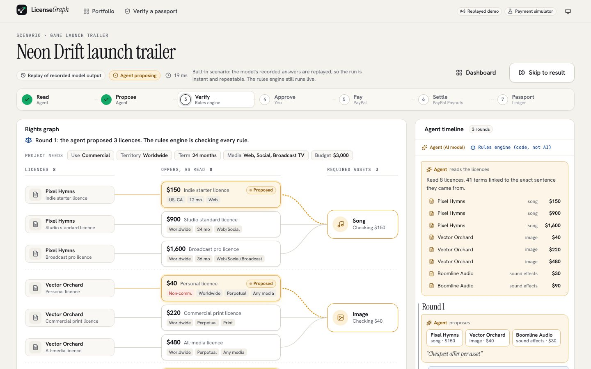

## Try it in two commands

```bash
git clone https://github.com/joyboyreturns/licensegraph && cd licensegraph
npm install && npm run demo          # then open http://localhost:3000
```

That needs **no accounts and no API keys**: the four built-in scenarios replay recorded model output (three end in a verified bundle; the fourth ends, honestly, with no bundle and a priced list of what to ask for), and a clearly labelled payment simulator stands in for PayPal. Press **Run the 60-second demo**, then follow the steps (approve, create the order, approve as the buyer in the simulator, watch the creators get paid, open the passport).

Requires Node.js 20.19 or newer (22 recommended). The first run builds the app (about a minute).

The **tour** (`/tour`) lists seven things to try in order, with what to look for in each.

## What you will see

| | |
|---|---|
| 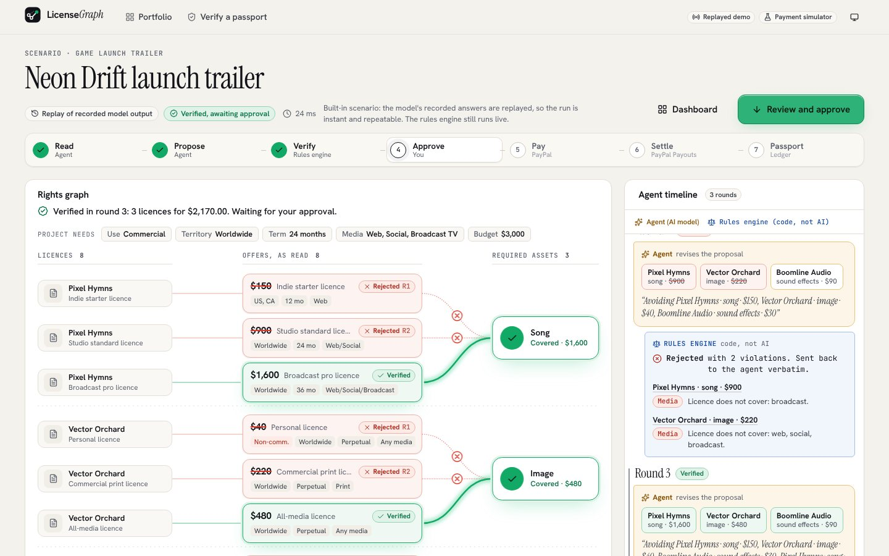 | **The loop is visible.** A hand-built rights graph shows licences, the offers the agent read, and the assets you need. The agent proposes (amber); the rules engine (blue, "code, not AI") rejects offers that break a rule and sends the reasons back; the agent revises. Replay it, scrub it, or skip to the result. |
| 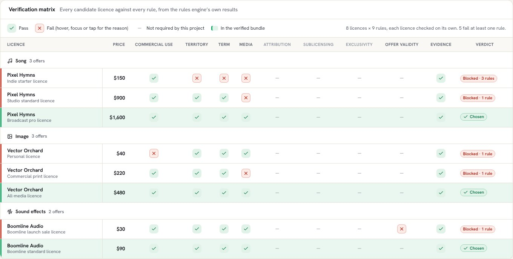 | **Every offer is checked against every rule**, not only the proposed bundle. A licence that is *silent* on something the project requires fails: gaps are never assumed away. |
| 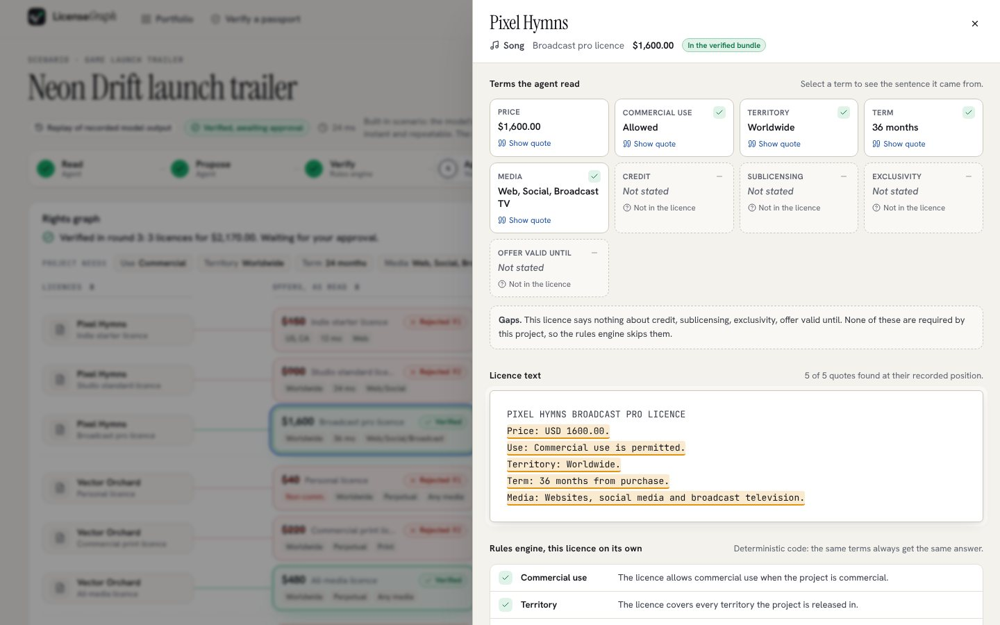 | **Every term links to the sentence it came from.** Quotes the model invents are rejected by code; the evidence viewer highlights the exact text. |
| 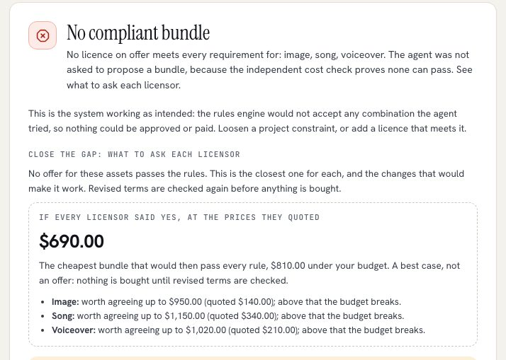 | **When the answer is no, it says what to ask for.** No licence meets every requirement, so nothing is proposed. The run names the closest licence per asset, the exact terms to change, drafts the message to each licensor, and prices the best case: "if every licensor said yes, at the prices they quoted". |
| 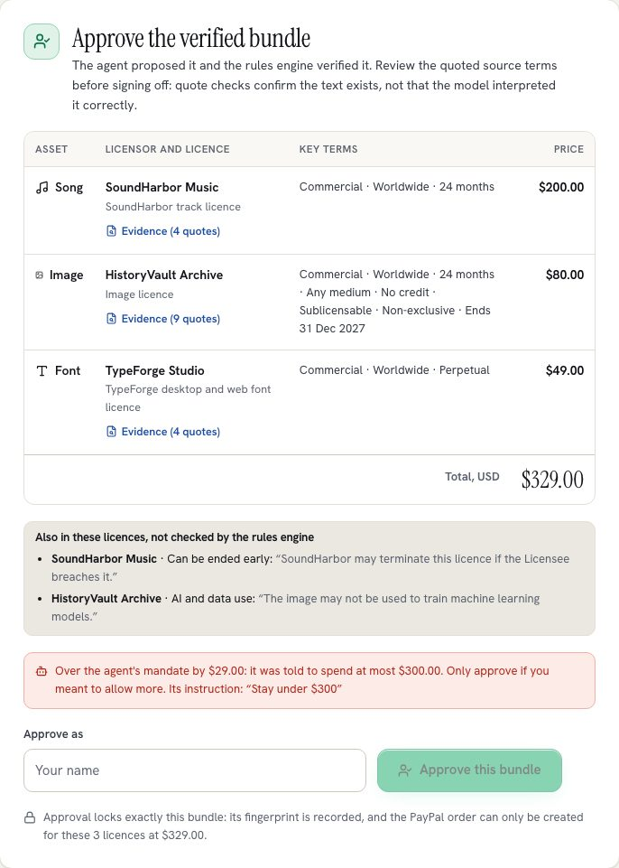 | **The person approves with the whole picture.** Beside the Approve button: who will be paid what once the payment is captured (addresses masked), the clauses in the licences that the rules engine does not check, quoted word for word, and, for a purchase an agent started, whether the verified total is within the spending cap the agent was given. |
| 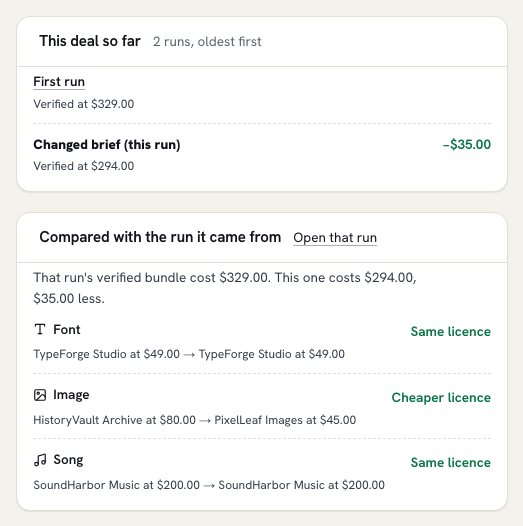 | **A negotiation is one record.** When you change the brief or a licensor replies, the new run opens beside the one it came from: each asset's licence and price before and after, the difference in the total, and every run of the deal listed in order. |
| 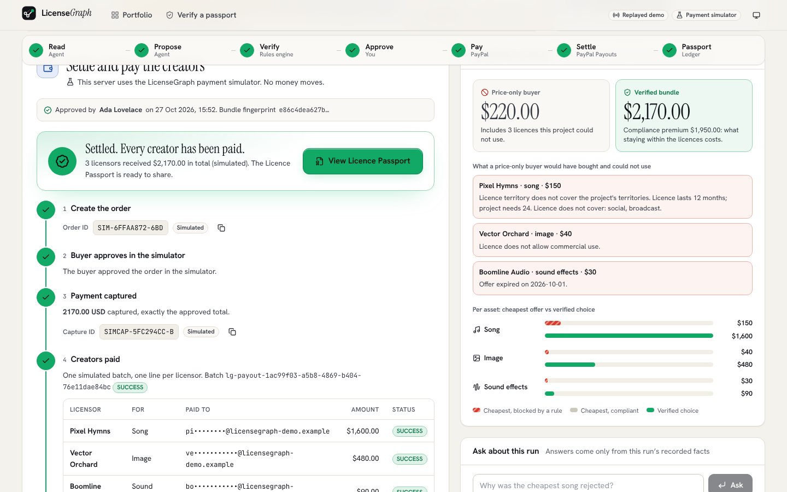 | **Settlement.** The order can only be created for the verified bundle a human approved. After the buyer approves, the payment is captured and each creator is paid. A submission failure never undoes the captured payment. Retries preserve the original batch id, recipients and amounts; individual failures require reconciliation rather than resending successful payments. |
| 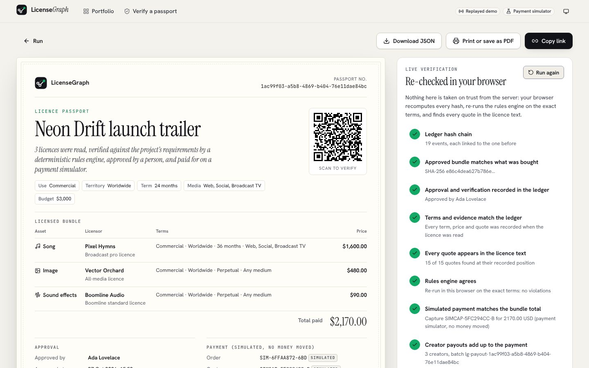 | **The Licence Passport** re-checks itself in your browser: the hash-chained ledger, the rules engine re-run on the exact terms, every quote found at its recorded position, and the PayPal capture and payout records. Download its licences as a spreadsheet (one row each, with price, terms, end date and payout status; a licensor's name can never run as a formula), print it, share it, or verify a downloaded file at `/verify`. A paid run also has a status badge for a README or a site (`/api/passports/{id}/badge`), built from the passport's own re-verification, so it can say "verified", "check failed" or "payment reversed" but nothing more than the record proves. |
| 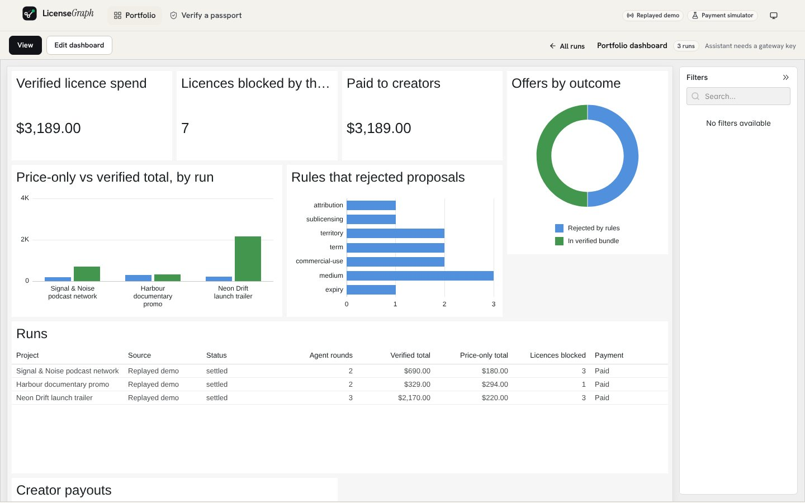 | **Portfolio dashboard** built with [AG Studio](https://www.ag-grid.com/studio/): spend, licences the rules blocked, creators paid, and every offer, violation and ledger event as linked tables. Its AI assistant builds new views from plain English (needs a model). Changes you make, including widgets the assistant builds, are kept in your browser (only a layout that differs from the original is saved), with a button to put the original back. |

On a phone it stays usable:

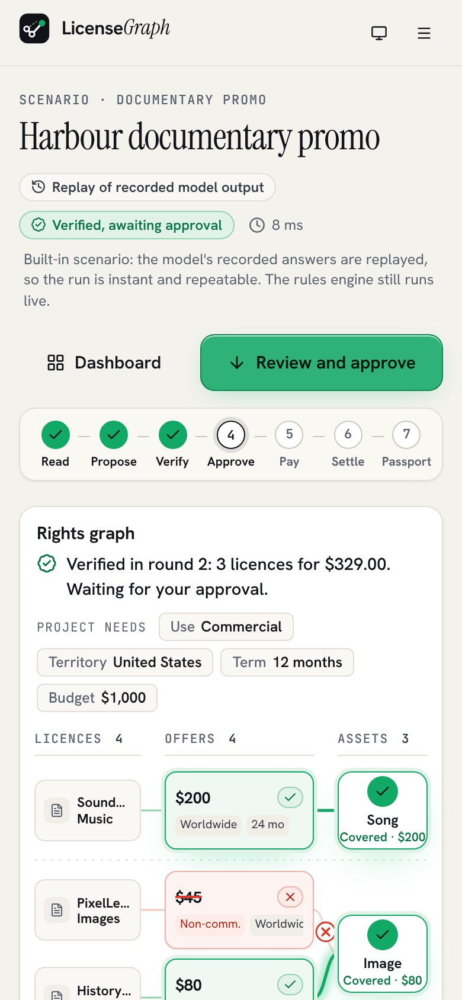

## Why it matters

Anyone who ships creative work (a game trailer, a podcast, a promo film) ends up with licences nobody has time to read: a song that is "worldwide" but only for web, an image that is "editorial only", a sound pack whose sale ended last month. A wrong licence can mean a takedown or a dispute, and the creators who made the work are paid late. In the demo scenarios a price-only buyer would have bought licences they could not legally use (for example a non-commercial image for a commercial promo); LicenseGraph shows exactly which rule blocked each one, and what staying compliant costs. Every number it shows is a price from an uploaded licence.

Licences can be pasted or loaded as a PDF or text file. A PDF is read in the browser with pdf.js, so the file itself is never uploaded; only the extracted text is sent when you start a run. A scanned PDF with no selectable text is rejected with an explanation instead of becoming an empty licence.

## Independent cost verification

The run page computes the exact cheapest compliant bundle from the uploaded offers, separately in each currency. It independently checks whether the agent found that minimum and shows the precise budget shortfall when no affordable bundle exists. All rights requirements stay in force. The method uses the current rules' independence between assets; every result is rechecked by the same rules engine, and property tests compare it with exhaustive enumeration.

## What each requirement costs, and what to ask for

Two further answers come from the same rules engine, with no model involved:

- **Requirement costs.** For every requirement the brief declares (media, commercial use, territory, term, credit, sublicensing, exclusivity) the run page shows what that requirement adds to the cheapest compliant bundle, by re-running the cost check with only that requirement dropped. A requirement that the cheapest licences already meet is shown as costing nothing. Tests compare every figure with an exhaustive search of all bundles through the real verifier.
- **Gap requests.** When no offer for an asset passes, the run no longer ends in a dead end: it finds the closest offer for each blocked asset, lists the exact terms to ask the licensor to change (territory, term, missing media, credit, and so on) and drafts the message, ready to copy. Revised terms are verified again before anything is bought. Licences are read three at a time (the model client paces its own requests) and recorded in document order. A run ends at once when the exact cost check proves some asset has no compliant offer, without spending a model round on a bundle that cannot exist. Each message opens in your email app or copies. Above them, **"If every licensor said yes"** prices the cheapest bundle that would then pass every rule at the prices already quoted, how far under budget that leaves you, and the most each asset could rise before the budget breaks, so you know what to concede in a negotiation. It is labelled a best case, not an offer (`src/core/negotiation.ts`; a property test checks the bundle it names passes the verifier at the stated total). The fourth built-in scenario, "Exclusive theme tune", ends here on purpose, and **"Simulate the licensors agreeing"** closes the loop offline: their exclusive replies are added and everything is checked again. With a live model, you paste a licensor's actual reply and it is read and checked the same way (`POST /api/sessions/{id}/revise`). Either way the answer is a **new run** linked to the first (`meta.revisedFrom`, and the first entry of its hash-chained ledger, so the negotiation also appears in the Licence Passport); the run that failed is never edited, so its record stays honest, and only a bundle that passes the rules can be approved and paid.

- **Saving levers.** For a verified bundle, the run lists each cheaper offer that fails only on terms its licensor could change, with the exact saving if they agreed at the price they quoted, what to ask, and a drafted message. Every lever is re-checked by the rules engine on the changed terms (a property test covers it), and it is always labelled a best case, never an offer. Agents get the same list from `cheapest_compliant_bundle`.
- **The fine print.** Beside the Approve button, any clause the rules engine does not check (a licence that can be ended early, a ban on training AI, limits on resale, liability, reporting duties) is quoted word for word from the bought licences, and the approval records how many were shown.

**What if the project changed?** Under the compliance summary, a panel lets you change the brief (where it is shown, how long, which media, whether it is commercial, credit, sublicensing, exclusivity) (by controls, or by typing a sentence such as "only Canada for 6 months, no exclusivity", read on your device) and see the new cheapest compliant bundle instantly, which asset's licence would change, and the delta against your brief. If no licence can cover the changed brief it says which asset and what to ask the licensor for. The panel's choices live in the page address, so a scenario can be shared as a link and reopened exactly (a hand-edited link is validated, never trusted). It re-runs the same exact cost check in the browser on the offers already read, so there is no model call and no estimate, and nothing on the run changes. Tests compare it against an exhaustive search of every bundle for random changes (`src/core/whatif.ts`). When a changed brief has a compliant bundle, **Check my licences against this brief** makes it real (`POST /api/sessions/{id}/rebrief`): a new run on the same licences, none of them read again, that can be approved and paid, linked to the first by a `brief_changed` ledger entry that the passport shows. The new run shows a side-by-side against the first (each asset's licence and price before and after, and the change in the total, from `src/core/compare.ts`), and the same panel appears on a run that answers a licensor's reply; the run's Ask box can also say, in words, how it differs from the run it came from. Every run in a negotiation (the first read, each licensor reply, each changed brief) is listed in order under "This deal so far", with how the total moved (`src/core/deal-history.ts`). The first run is never edited.

Both are also tables in AG Studio (`requirements`, `gaps`), and the portfolio has a `licences` table of when each bought licence ends, drawn by a second custom widget (a licence timeline with a today line and the licences ending soon highlighted), so the dashboard and its assistant can chart and filter them across runs.

The dashboards also include a **custom Studio widget**, the *rule matrix* (`app/dashboard/rule-matrix.tsx`): a heat grid of which rule rejected which asset, across every run on the portfolio page. It is a real Studio widget type, not a chart in disguise. It appears in the widget menu, takes its fields through the edit panel, and follows the page's filters and cross-filtering. The grouping logic is plain code with unit tests (`src/dashboard/rule-matrix.ts`).

Two more custom widgets sit beside it, built the same way: a *licence timeline* (`licence-timeline.tsx`, a bar for each bought licence from the day of purchase to the day it stops covering the project, with a line for today) and a *money flow* (`money-flow.tsx`, what buyers paid drawn as bands flowing to each creator). Their layout code is also pure and tested, and the dashboard assistant has a tool for each.

Each licence in a passport also links to a printable **creator receipt** (`/passport/<run id>/receipt/<asset>`): the price, the payout to that creator, the terms, when the licence ends, and the quoted sentences they came from.

The rules themselves are explained on one page of the app (`/rules`): every rule, when the brief makes it apply, and what happens when a licence is silent. A test keeps that page in step with the engine's rule list.

## Check a passport without the app

A Licence Passport can be re-verified from a terminal, with no browser and no running server: `npm run verify:passport -- licence-passport.json` (a file saved from the passport page), or pass the address of a running instance's `/api/passports/<run id>`. It recomputes the hash chain, the bundle digest, the quotes and the rules-engine verdict, prints one PASS or FAIL line per check, and exits 0 only when every check passes, so it fits in a script or a CI job.

## Agents can shop, only people can spend (MCP)

`scripts/mcp-server.ts` exposes LicenseGraph as a [Model Context Protocol](https://modelcontextprotocol.io) server over stdio, so any MCP-capable AI agent can use it:

| Tool | What it does |
| --- | --- |
| `check_licence_bundle` | The rules engine's verdict on a proposed bundle, with every violation |
| `cheapest_compliant_bundle` | Exact minimum cost, what each requirement adds, what to ask for where nothing passes, and the best-case total and per-asset price ceiling if every licensor agreed |
| `what_if_brief` | The exact cost if the brief changed (territory, term, media, a requirement added or dropped), what shifts, and what to ask a licensor where nothing fits |
| `compare_runs` | Sets two runs side by side from their verified bundles: which asset's licence changed, what each costs, and the difference in the total. Read-only. |
| `verify_licence_passport` | Re-checks a paid purchase's Licence Passport on the server (hash chain, quotes, rules re-run, PayPal capture and payouts, signature), so an agent confirms a licence is cleared before relying on it |
| `licence_fine_print` | The clauses in each licence the rules engine does not check (early termination, AI-training bans, resale limits, liability, reporting), quoted word for word, to show the person before they approve |
| `licence_end_dates` | When each licence stops covering the project, from the day of purchase, with an iCalendar file holding a reminder 30 days before each end |
| `start_licence_purchase` | Reads raw licence texts, proposes and verifies a bundle, and returns a claim link for a person |
| `get_purchase_status` | Verified bundle, approval, PayPal capture, creator payouts and the Licence Passport link |

The **Agents** page (`/agents`) shows how to connect, lists the tools live from the endpoint, and plays an agent session against it that you can watch (every figure comes from the tools). It also offers the rules as a resource (`licensegraph://rules`: each rule, when it applies, and what a licence's silence means) and a paid purchase's signed passport (`licensegraph://passport/{runId}`), which an agent can keep and re-check offline with the published key. The same server is also served **over HTTP at `/api/mcp`** (Streamable HTTP, stateless), so an agent can connect to a running instance without cloning anything: in an MCP client that supports remote servers, add `{ "url": "http://localhost:3000/api/mcp" }` (or your deployment's address). It offers exactly the same tools, and the same rule holds: the agent can check, price and start a purchase, and only a person with the claim link can approve and pay. An agent can also find the endpoint without being told: `/llms.txt` (the plain-text introduction agents and crawlers read first; `/llms-full.txt` adds the rules and the buying playbook) and `/.well-known/mcp.json` (a server card) are generated from the running server's own tool list, so they cannot drift from it, and `robots.txt` and `sitemap.xml` keep runs, claim links and passports out of crawlers while leaving the public pages open.

It also offers a `buy_licences` prompt: the order an agent should work in (read the licences into offers, price them, negotiate when nothing passes, hand the person the claim link), which keeps every figure coming from the tools and approval and payment with the person.

The agent cannot approve or pay. A run started this way belongs to an owner id no browser holds, so approving and paying are refused until a person opens the claim link and clicks to take control. The link carries a one-time token stored only as a hash; opening it (or a chat app previewing it) changes nothing, and the handover is recorded in the hash-chained ledger and shown in the Licence Passport.

An agent can also pass a **mandate**, the spending cap its person gave it (`mandate` on `start_licence_purchase`, or `{ maxTotalCents, currency, note }` on `POST /api/sessions`). Once the bundle is verified, code compares the total with the cap and writes a `mandate_checked` event to the ledger; the approval screen shows "within" or "over by $X" next to the Approve button, and the passport records it. It is information for the person, not a permission: the agent still cannot approve or pay, and a cap in another currency is reported as not comparable rather than guessed. A mandate can also limit single licences: `maxPerLicenceCents` (`maxPerLicence` over MCP) and `avoidLicensors`, a list of licensors the person does not want to buy from. Any licence in the verified bundle that breaks one is named beside the Approve button, written to the same ledger event, and reported by `get_purchase_status`.

```bash
LICENSEGRAPH_URL=http://localhost:3000 npx tsx scripts/mcp-server.ts
# in an MCP client: { "command": "npx", "args": ["tsx", "scripts/mcp-server.ts"], "env": { "LICENSEGRAPH_URL": "http://localhost:3000" } }
```

## HTTP API (OpenAPI)

Everything the pages do goes through a plain JSON API, described by an OpenAPI 3.1 document: served live at `/api/openapi.json` and committed as [`docs/openapi.json`](docs/openapi.json) for importing into API tooling (SDK generators, Postman, a docs portal). It is generated from the same zod schemas the server validates with, and `tests/openapi.test.ts` fails if a route is missing from it, if the committed copy is stale, or if a real response no longer matches its published schema. After changing the API, run `npm run openapi`.

Money-moving calls (`approve`, `pay`, `capture`, `payouts`, `refund`) need the `lg_owner` cookie of the browser that started or claimed the run; an agent-started run (`handoff: true`) cannot be approved until a person claims it.

## How PayPal is used

- **Orders API (Sandbox):** create order, buyer approval, capture, with stable, bounded idempotency keys and coalesced concurrent requests. Orders are created only through a gate that re-verifies the bundle and requires a human approval for exactly that bundle. The order is itemised (one line per licence, so the PayPal checkout page shows what is being bought) and carries the approved bundle's digest as its `custom_id`, so a transaction found in PayPal can be matched to the exact bundle a person approved; the webhook that captures an approved order refuses one whose digest differs.
- **Payouts API (Sandbox):** after capture, each licensor is paid the price of their licence in one batch. Payout status is tracked per recipient. A batch is settled only when every creator payment succeeds; uncertain submissions reuse the same batch key when retried.
- **Refunds API (Sandbox):** if the creators could not be paid, the buyer's payment can be returned in full (`POST /v2/payments/captures/{id}/refund`, idempotent). A refund is offered only when it is certain no creator was paid (nothing was sent, PayPal denied the whole batch, or it was rejected outright); after an unsure failure such as a timeout it is refused until the batch is reconciled, because refunding then could lose the money twice. The refund is recorded in the hash-chained ledger and no Licence Passport is issued for a refunded purchase.
- **Webhooks (Sandbox):** `POST /api/webhooks/paypal` accepts PayPal's notifications and acts only after PayPal itself confirms the signature (`/v1/notifications/verify-webhook-signature`, against `PAYPAL_WEBHOOK_ID`). An approved order is captured even if the buyer closes the tab before returning, payout batch changes refresh the run, and a refund or reversal made outside the app is written to the ledger so the Licence Passport fails its "payment has not been reversed" check instead of claiming licences that are no longer paid for. Every action is one the app already takes, with the same guards and idempotency, so a redelivered event changes nothing. Register the webhook for `CHECKOUT.ORDER.APPROVED`, `PAYMENT.PAYOUTSBATCH.*`, `PAYMENT.CAPTURE.REFUNDED` and `PAYMENT.CAPTURE.REVERSED` at your public URL (Sandbox app > Webhooks) and set `PAYPAL_WEBHOOK_ID`. Without it the endpoint answers 503.
- **Agentic commerce:** an AI agent, ours or any MCP client, initiates the purchase. Deterministic verification and a human who has explicitly taken control stand between that proposal and any money moving; PayPal executes the payment and the payouts.

## How AI is used

- A language model reads each licence and extracts structured terms **with evidence quotes** (validated by code).
- A language model **proposes** the bundle and **revises** after the verifier's rejections.
- A language model (with an offline fallback) turns a plain-English **brief** into project requirements; every assumption is shown separately from what the text said.
- **Ask about this run** answers questions only from the run's recorded facts; cited offers are checked by code.
- The AG Studio **dashboard assistant** builds charts, tables, headline numbers and the licence timeline through a few validated tools.
- The model **never** verifies its own output, never creates orders, and never sees payment credentials. It is also never trusted: it can only choose real offers by id, and its structured output and quote locations are checked. Quote matching does not prove the interpretation is correct; the approver must review the source terms.

Models run through the Vercel AI Gateway, and the client **refuses any model the gateway does not list as free**, so credits cannot be spent.

## Using real PayPal Sandbox and a live model

```bash
cp .env.example .env        # then fill in what you have
npm run build && npm start  # or: npm run dev
```

- **PayPal Sandbox:** create a *Merchant* app on [developer.paypal.com](https://developer.paypal.com) under Sandbox, use **United States** Sandbox accounts (India-region accounts cannot transact in USD), and set `PAYPAL_CLIENT_ID` and `PAYPAL_CLIENT_SECRET`. The app only talks to the Sandbox host and refuses anything else. Add a few Sandbox personal accounts to `LICENSEGRAPH_CREATOR_EMAILS` to see the creator payouts land as SUCCESS.
- **No PayPal account?** Set `LICENSEGRAPH_SIMULATOR=1` instead: the same order, approval, capture and payout flow runs locally against a labelled simulator.
- **Your own licences:** set `AI_GATEWAY_API_KEY` and a **free** `LICENSEGRAPH_MODEL`, then use *Describe your project* on the home page. Live runs are slower (free models are rate limited, so calls are spaced about 12 seconds apart).
- **Dashboard licence:** AG Studio is commercial; without `NEXT_PUBLIC_AG_STUDIO_LICENSE_KEY` it runs with a trial watermark.

All settings are documented in [`.env.example`](.env.example). Running it on a home server behind Tailscale Funnel is covered in [`docs/DEPLOY.md`](docs/DEPLOY.md).

## How it is built

```
licence text ──► extract (model + code checks) ──► propose (model) ──► verify (rules engine) ─┐
                      ▲ quotes must exist            only real offers        pure, no AI       │ rejected: reasons
                      │ in the licence                                                         │ go back verbatim
                      └───────────────────────────── revise ◄──────────────────────────────────┘
verified ──► human approval (locks the bundle digest) ──► PayPal order ──► buyer approves ──► capture ──► creator payouts ──► Licence Passport
                              every step is appended to a hash-chained ledger
```

| Path | What it holds |
|---|---|
| `src/core` | The rules engine (`verifyBundle`, `evaluateOffer`), the price-only comparison, canonical hashing. Pure TypeScript shared by server and browser. |
| `src/extraction`, `src/agent` | Term extraction with evidence checking; the propose-verify-revise loop; model clients (free-models-only guard, rate pacing). |
| `src/ledger` | Hash-chained, append-only event log; browser-safe verification. |
| `src/payments` | PayPal Orders and Payouts client (Sandbox only), the approval-gated checkout, creator payout planning, the offline simulator. |
| `src/passport` | Passport builder and the in-browser verifier. |
| `src/app-logic` | The session flow that enforces the order of steps, and persistence. |
| `src/server`, `app/api` | Runtime wiring, owner cookies, the model proxy, rate limits, HTTP routes. |
| `src/ui`, `app` | The Next.js front end: home, run theatre, passport, verify, simulator checkout. |
| `src/dashboard`, `app/dashboard` | AG Studio dashboards and the validated assistant tools. |
| `src/demo`, `src/intake` | Built-in scenarios and recorded outputs; the plain-English brief reader and run Q&A. |

More detail, including the trust boundaries and decisions, is in [`docs/ARCHITECTURE.md`](docs/ARCHITECTURE.md).

**Trust boundaries in one line each:** the agent may extract, propose and revise, but may not verify, create orders, or see credentials. The rules engine decides and never calls a model. Payment code requires a passing verdict **and** an approval for exactly that bundle. Money is integer cents in one supported two-decimal currency per bundle. Budgets in the brief editor are USD; the API can declare a different project currency, and never assumes an exchange rate. PayPal calls go only to the Sandbox.

## Tests

```bash
npm test               # unit, property and API tests, no network
npm run typecheck
npm run test:e2e       # real browser journeys against the offline demo (needs: npx playwright install chromium)
npm run test:live      # PayPal Sandbox (needs credentials)
npm run test:gateway   # free-model extraction (one request per fixture)
```

The suite covers the rules, the payment gate, payouts and their failure and retry, ledger and passport tamper detection (forged prices, terms, quotes, capture ids, edited ledger events), persistence, API routes and run ownership, the offline simulator, a check that browser-bound modules never import Node code, and full browser journeys including the mobile layout.

## Security and privacy notes

- Sandbox only. The app refuses any PayPal host other than the Sandbox API.
- A run belongs to the browser that created it (an anonymous, HttpOnly cookie): only that browser can approve, pay or list it. Anyone holding a run or passport link can *read* it, so a passport can be shared; do not run confidential licences through a public instance.
- Creator email addresses are masked in the UI and never stored in the ledger or passport.
- Every response carries `X-Content-Type-Options: nosniff`, `X-Frame-Options: DENY`, a strict `Referrer-Policy`, a locked-down `Permissions-Policy` and a `Content-Security-Policy` that only forbids framing, plugins and a changed base address (so nothing the app loads is affected). The public agent endpoint caps how much one call may carry (200 offers, 50 assets, 20 quotes per offer), and a model run is limited to three at a time.
- Passports are tamper-evident and, when `LICENSEGRAPH_PASSPORT_SECRET` is set, signed with an Ed25519 key derived from that secret. The server publishes the public half at `/.well-known/licensegraph-keys.json`, so anyone can confirm who issued a passport, offline and without the secret: `npm run verify:passport -- licence-passport.json --key <public key>` (pin the key you were given rather than fetching it from the same place as the passport). The Verify page does the same in the browser: paste the issuer's public key and it checks the signature with WebCrypto, with no server involved, and a tampered copy fails it. "Verified" proves the record is consistent and unchanged. It does **not** prove the licence documents are genuine or that the licensor owns the rights, and it is not legal advice.

## AI tools disclosure

- **In the product:** a free language model through the Vercel AI Gateway (licence term extraction, bundle proposals, brief reading, run Q&A and the dashboard assistant), as described above.
- **In development:** AI coding tools were used to help write and test the code, under the author's direction. The author reviewed the work and takes responsibility for it.

Audit results and the remaining submission work are in [`docs/AUDIT.md`](docs/AUDIT.md) and [`docs/HACKATHON.md`](docs/HACKATHON.md).

## Documents

[`docs/ARCHITECTURE.md`](docs/ARCHITECTURE.md) · [`docs/PLAN.md`](docs/PLAN.md) · [`docs/DEPLOY.md`](docs/DEPLOY.md) · [`docs/DEVPOST.md`](docs/DEVPOST.md) · [`docs/DEMO_SCRIPT.md`](docs/DEMO_SCRIPT.md) · [`docs/openapi.json`](docs/openapi.json)

## Licence

MIT. See [`LICENSE`](LICENSE). AG Studio is a separate commercial product with its own licence.
