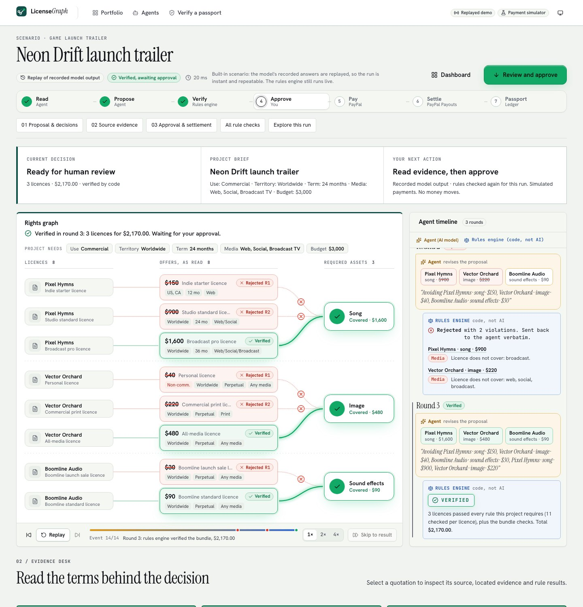
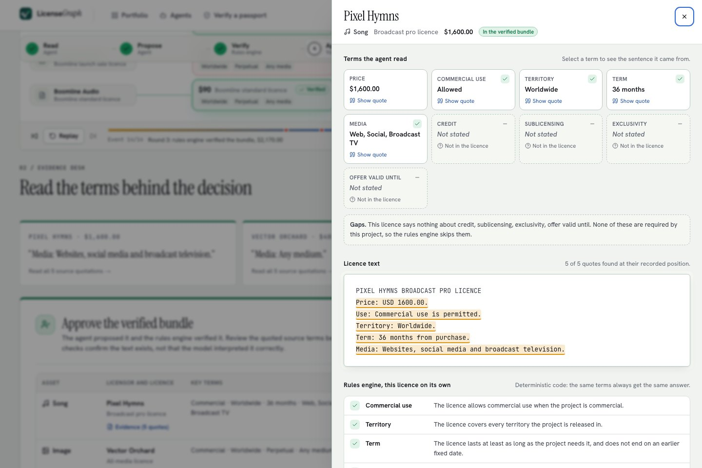
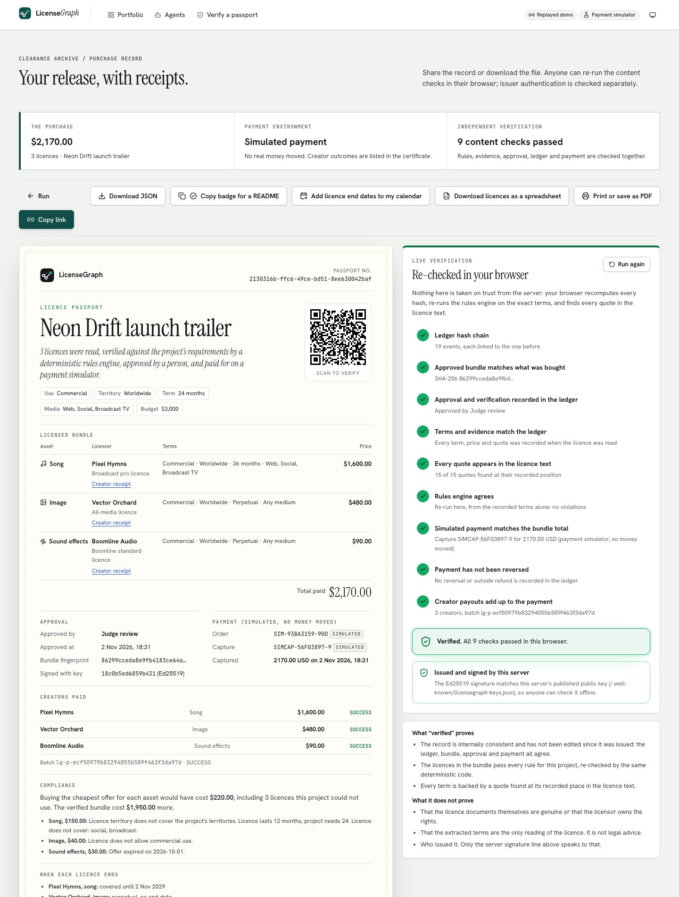

# LicenseGraph

[](https://github.com/joyboyreturns/LicenseGraph/actions/workflows/ci.yml)

LicenseGraph checks whether a set of creative-asset licences fits a project, then takes the approved bundle through checkout and creator payouts. Built for the PayPal AI Hackathon 2026.

The main demo is a game trailer that needs music, key art and sound effects. The cheapest offers add up to $220, but they don't cover the brief. After two rejected proposals, the verified bundle costs $2,170. You can inspect the source terms and rule decisions before approving it. These are sample licences and prices.



## Run it locally

Use Node.js 22, or at least 20.19.

```sh
git clone https://github.com/joyboyreturns/LicenseGraph.git
cd LicenseGraph
npm install
npm run demo
```

Open [localhost:3000](http://localhost:3000). The first launch builds the app.

The demo needs no accounts or API keys. It uses recorded model output and a deterministic stand-in proposer; the rules engine runs on every proposal. Checkout and payouts use a labelled simulator. No money moves. The demo launcher disables model and payment credentials for its process, even if you have a local `.env`.

After changing the source, rebuild with `npm run demo -- --build`. To use another port, run `npm run demo -- --port 3400`.

## Try the game trailer

1. Press **Explore the game trailer demo**. Watch the proposals get rejected and revised, or skip to the result.
2. Open a source quotation. The evidence drawer shows the licence text and the rules that passed or failed.
3. Review the verified bundle, enter your name and approve it. Then create the simulated order and approve the buyer's payment in the simulator.
4. Inspect the creator payouts and open the **Licence Passport**. Download its JSON and check it at `/verify`; the tampered-copy button shows what happens when the record changes.

For a case that cannot be bought, try **Exclusive theme tune**. None of the licences grants exclusivity. The app shows what would need to change, and can replay revised licensor replies as a new run.

The run also has what-if controls and negotiation options under **Work the alternatives**. The dashboard's fixed actions work offline and can add views of rejected offers and prices. Its live assistant is optional.

[The local judge guide](docs/JUDGE.md) has the longer walkthrough and recovery steps.

## What makes the decision

A model extracts terms and proposes offers. `verifyBundle` checks the proposal against the project's requirements: commercial use, territory, duration, media, credit, sublicensing, exclusivity, expiry, currency, evidence and budget. If a required permission isn't stated, the offer fails.

Each extracted term needs a quotation located in the source document. The verifier does not call a model. A separate cost check finds the cheapest compliant bundle in the supplied catalogue and compares it with the proposal.

Checkout re-runs verification and checks that the human approval matches the exact terms, evidence and prices being bought. Money is stored as integer cents, with one currency per bundle.

After capture, creator payouts are tracked individually. A failed payout does not undo the buyer's capture. An uncertain payout must be reconciled before it can be submitted again.

The Licence Passport contains the bought licences, approval, payment and payout records, and a hash-chained event log. Its content checks run in the browser or from a downloaded file:

```sh
npm run verify:passport -- licence-passport.json
```

An optional server signature identifies the issuer. Checking a signature independently requires a public key you trust.

<details>
<summary>Evidence and passport screenshots</summary>





</details>

## Use your own licences or PayPal Sandbox

Copy `.env.example` to `.env` and follow its comments. Start with `npm run dev`, or `npm run build && npm start`; `npm run demo` deliberately keeps using the offline setup.

Custom licence extraction needs `AI_GATEWAY_API_KEY` and `LICENSEGRAPH_MODEL`. The client checks the gateway's price list and refuses paid or unlisted models. Free-model availability and latency vary. The offline brief reader and recorded scenarios remain usable without one.

For PayPal Sandbox, configure the Sandbox client credentials and creator test accounts listed in [`.env.example`](.env.example). The payment client refuses live PayPal hosts. Buyer approval is still required. Files can be pasted or loaded from text-based PDFs; PDF parsing happens in the browser, and only the text is sent when starting a custom run.

### Webhooks

For Sandbox callbacks, register `<public URL>/api/webhooks/paypal` in the Sandbox app and set `PAYPAL_WEBHOOK_ID`. Subscribe to `CHECKOUT.ORDER.APPROVED`, `PAYMENT.PAYOUTSBATCH.*`, `PAYMENT.CAPTURE.REFUNDED` and `PAYMENT.CAPTURE.REVERSED`. The server verifies provider signatures before acting. This needs a reachable server; the offline demo doesn't require it.

## Working on the code

This is a Next.js/React app written in TypeScript. The rules engine is shared between the server and browser. AG Studio supplies the dashboards and pdf.js reads PDFs.

```text
src/core        Rules, cost checks and what-if calculations. No network or disk access.
src/extraction  Licence extraction and source-quotation checks.
src/agent       Proposal and revision loop.
src/payments    Approval gate, PayPal Sandbox client and payment simulator.
src/ledger      Hash-chained event log.
src/passport    Passport creation and verification.
src/app-logic   Run lifecycle and persistence.
app             Pages and HTTP routes.
src/ui          Components and browser helpers.
```

The [architecture document](docs/ARCHITECTURE.md) covers the modules and trust boundaries. The HTTP API is documented in [OpenAPI](docs/openapi.json), also served at `/api/openapi.json`. Agents can connect through MCP at `/api/mcp`; the app's `/agents` page has connection instructions. Agents can check licences and start a purchase, but a person must claim the run before approving or paying.

## Tests

```sh
npm test
npm run typecheck
npx playwright install chromium  # once
npm run test:e2e
```

The browser suite builds the app and runs against the offline demo. It covers purchases, rejected bundles, payout failures, refunds, ownership, passport tampering, and desktop/phone accessibility checks. Credential-dependent tests are skipped by default. Dated results and separate provider checks are in [READINESS.md](docs/READINESS.md).

## Limits

This is still a prototype. Matching a quotation proves the text exists; it doesn't prove the extraction is the right legal interpretation, the document is genuine, or the seller owns the rights. Source review matters.

The cost check covers the supplied offers and implemented rules. It doesn't handle mixed-currency bundles, exchange rates or discounts that depend on buying several assets together. Scanned PDFs need transcription; there is no OCR.

Run ownership uses an anonymous browser cookie, not a full account system. Run and passport links are readable by anyone who has them. Keep confidential documents on a private instance.

Payments are limited to Sandbox or simulation. Deployment is deferred; use the local demo for now. AG Studio has a separate commercial licence and may show a trial watermark without a key.

## Further reading

- [Demo recording script](docs/DEMO_SCRIPT.md)
- [Verification evidence and remaining release work](docs/READINESS.md)
- [Development plan](docs/PLAN.md)
- [Deployment notes](docs/DEPLOY.md)

AI assistance was used while writing and testing parts of this project.

## Licence

[MIT](LICENSE). AG Studio is covered by its own licence.
